<div align="center">

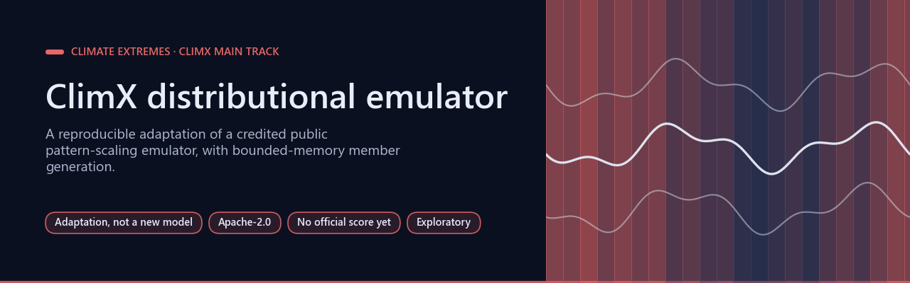

# ClimX distributional emulator

[](https://github.com/Agnuxo1/climx-distributional-emulator/actions/workflows/release.yml) [](LICENSE)   [](docs/official-readback.json) [](https://www.kaggle.com/competitions/climx-main-track)

[**Provenance**](#provenance-and-measured-status) · [**Reproduce**](#reproduce) · [**Licence**](#licence) · [**NOTICE**](NOTICE) · [**Research protocol**](docs/RESEARCH_PROTOCOL.md) · [**Official read-back**](docs/official-readback.json) · [**Bibliography**](#bibliography)

</div>

A reproducible adaptation of the credited public distributional pattern-scaling emulator for the [ClimX main track](https://www.kaggle.com/competitions/climx-main-track), with bounded-memory member generation and an experimental longitude-smoothing option.

**Contents** — [Provenance and measured status](#provenance-and-measured-status) · [Background](#background) · [Reproduce](#reproduce) · [Real-world applications](#real-world-applications) · [Possible improvements](#possible-improvements) · [Future work](#future-work) · [Licence](#licence) · [Bibliography](#bibliography)

## Provenance and measured status

<p align="center">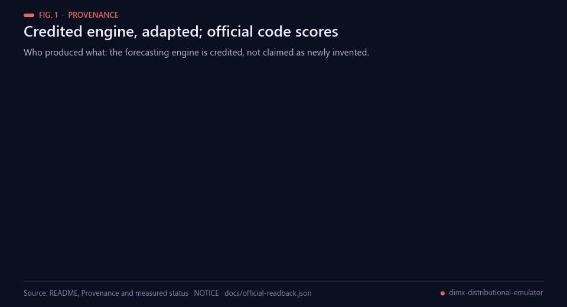<br><sub>Fig. 1 — Provenance. Data: README and NOTICE; no submissions are recorded in docs/official-readback.json.</sub></p>

The forecasting engine comes from **maverickss26/climx-sota-main-track**. It is not represented as a newly invented model. [NOTICE](NOTICE) records that source and changes. The official [IPL-UV/ClimX](https://github.com/IPL-UV/ClimX) code computes submission indices. Our existing pixelflow/reservoir technologies are candidate hybridisations; **no reservoir contribution has yet been implemented or measured in this engine**.

<p align="center">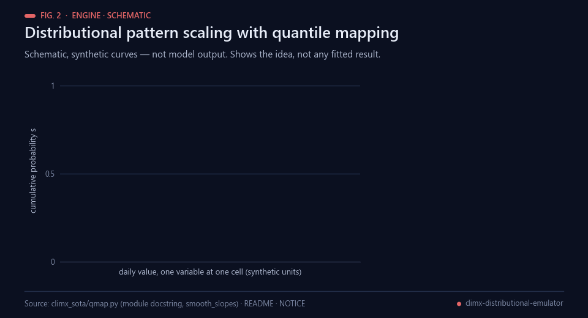<br><sub>Fig. 2 — Schematic, synthetic curves; not model output. Idea taken from the docstring of climx_sota/qmap.py.</sub></p>

<p align="center">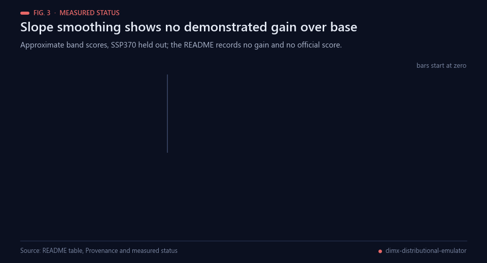<br><sub>Fig. 3 — Recorded scores from the table below: no demonstrated gain from slope smoothing.</sub></p>

| Experiment/check | Recorded outcome | Scope |
|---|---|---|
| Base, 16 members, 8 bands, SSP370 held out | approximately 0.1681 | Approximate band score without AR6 regions; not official leaderboard |
| Slope smoothing 5, matched panel | approximately 0.1680 | No demonstrated gain over base; exploratory |
| Parallel refactor, original thread mismatch |13/15 indices close; R95p differed0.019 and SDII0.004 | Technical mismatch retained |
| Corrected identical OMP=2 verification |15/15 indices difference0.0 on band0 | Numerical equivalence on one band; not model-quality gain |

<p align="center">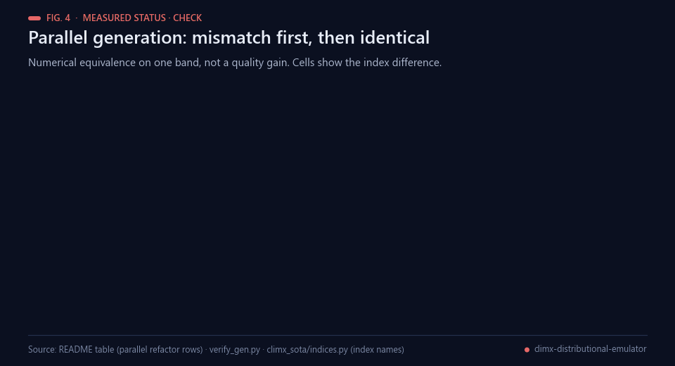<br><sub>Fig. 4 — Serial versus parallel generation: numerical equivalence on one band, not a quality gain.</sub></p>

The 64-member prediction is running on servidor-ia, job 1fc48030296c4f63. Earlier interrupted runs and their retained band caches are technical history, not independent quality trials. There is no completed prediction, official score or measured own-technology gain in this snapshot.

## Background

<p align="center">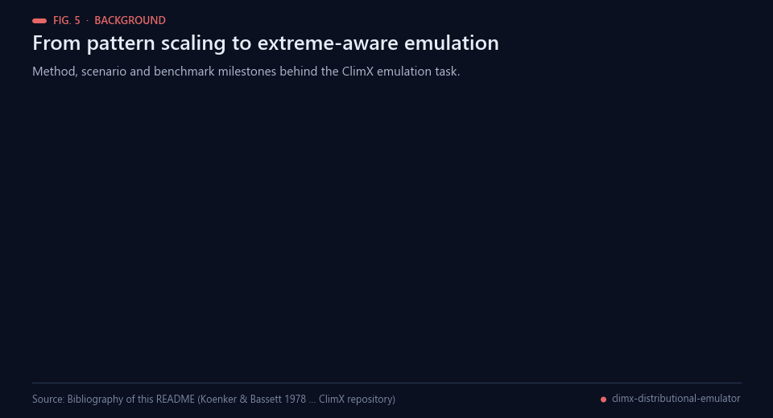<br><sub>Fig. 5 — Milestones behind this work. Sources: bibliography below.</sub></p>

Pattern scaling describes the local response of a climate variable as a fixed spatial pattern per unit of global
warming; its accuracy was examined by Mitchell [[1](#ref-1)] and its strengths and limits revisited with newer model
output by Tebaldi and Arblaster [[2](#ref-2)]. The forcing scenarios that such emulators learn from come from CMIP6
[[3](#ref-3)] and its ScenarioMIP experiments [[4](#ref-4)], and the extremes that matter for impacts are summarised by
standard indices computed from daily temperature and precipitation [[5](#ref-5)], which libraries such as xclim
implement [[8](#ref-8)]. Statistical emulators then moved from mean temperature to grid-point realizations, as in MESMER
[[6](#ref-6)], and to shared benchmarks, as in ClimateBench [[7](#ref-7)]. The ClimX benchmark asks for daily fields from
greenhouse-gas and aerosol forcings, scored on 15 extreme indices computed by the official code [[12](#ref-12)]; the
approximate band score in this repository leaves out the AR6 reference regions [[10](#ref-10)], which the
README names as missing.

The engine adapted here is a distributional variant of pattern scaling. Each quantile level of the daily
distribution is modelled as a linear function of forcing predictors, in the spirit of regression quantiles
[[11](#ref-11)]; a borrowed training day is placed on its probability level and re-read from the target year's quantile
function, an idea related to quantile-mapping methods [[9](#ref-9)]. [NOTICE](NOTICE) calls the smoothed slopes
"quantile-regression slopes", while the module docstring of `climx_sota/qmap.py` describes a ridge regression of each
quantile level; this README does not go beyond those two statements. The forecasting engine comes from a public Kaggle
notebook [[13](#ref-13)] entered in the competition [[14](#ref-14)]. The author's pixelflow and reservoir technologies are only
candidate hybridisations at this point: none is implemented or measured in this engine.

## Reproduce

<p align="center">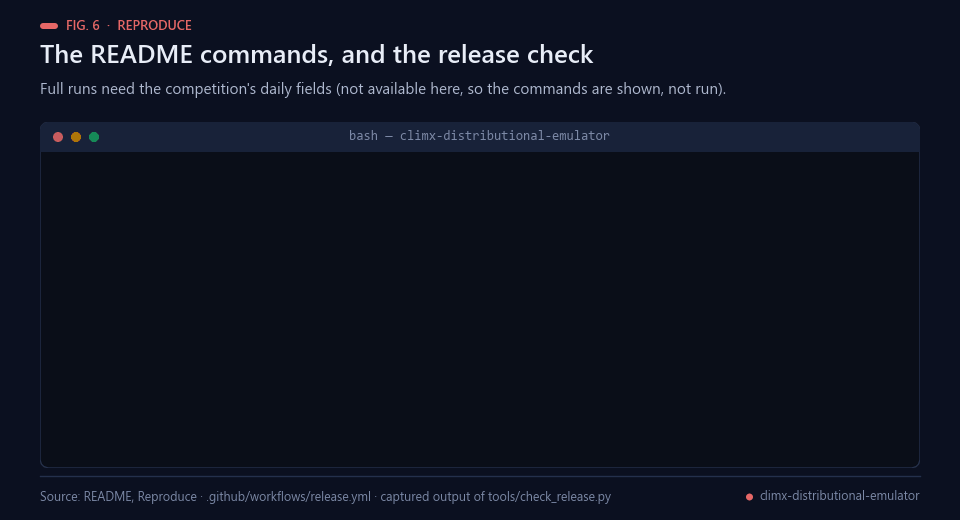<br><sub>Fig. 6 — The README commands (not run: they need competition data) and the captured release-check output.</sub></p>

Linux, Python 3.11+, sufficient RAM and disk for full climate data. Use the competition's allowed daily fields and forcing files. Do not commit them.

```bash
python -m pip install -r requirements.txt
python run_sota.py --help
python run_sota.py validate --holdout 370 --members 16
```

The inherited server driver explicitly expects `/home/ai/proyectos/climx/{data/full,store_full,cache_bands}` and completion records in `data/descarga.log`. Configure those locations before a new run; `repack` builds the band store. `predict_go3.sh` records bounded-memory/parallel settings. `verify_gen.py` compares a frozen serial and parallel band cache. Dependencies are a declared environment, not a complete frozen lockfile.

<p align="center">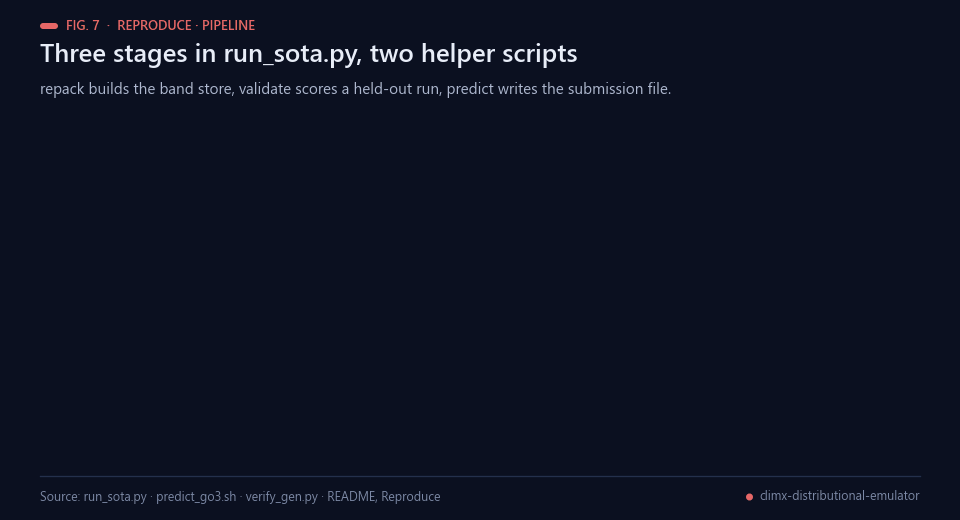<br><sub>Fig. 7 — Stages of run_sota.py and the two helper scripts.</sub></p>

The official rules require generating daily fields first, then computing indices with official code. Index-space score manipulation is not an authorised shortcut. Read [research protocol](docs/RESEARCH_PROTOCOL.md); future hybridisation needs a fixed-control ablation and independent confirmation.

## Real-world applications

<p align="center">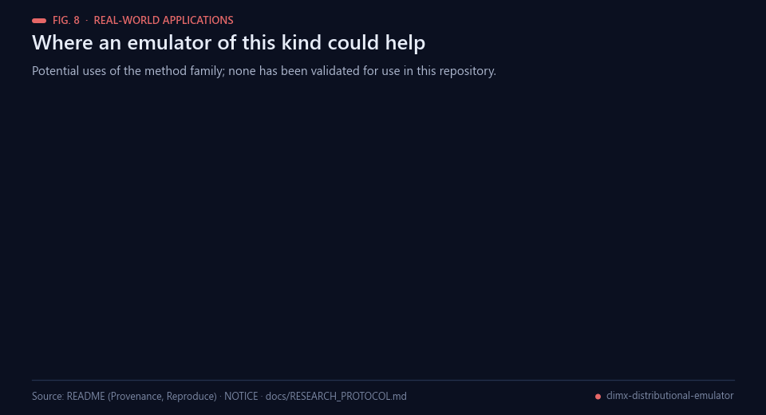<br><sub>Fig. 8 — Potential uses of this method family; none is validated in this repository.</sub></p>

Emulators of this kind are studied because they are far cheaper to run than the Earth system models they imitate
[[6](#ref-6), [7](#ref-7)]. The following uses are potential, not demonstrated here:

- **Fast scenario exploration.** Daily fields for a new forcing pathway without rerunning an Earth system model
  (speed is not measured in this repository).
- **Extremes indices for impact studies.** Heat, cold, drought and heavy-rain indices [[5](#ref-5), [8](#ref-8)] computed from
  emulated daily fields, the quantities impact assessments typically consume.
- **A documented baseline for hybrid ideas.** A credited engine with a fixed control, against which reservoir or
  pixel-based variants could later be compared under the research protocol.
- **Modest-hardware runs.** Bounded-memory, fork-parallel member generation aims to fit climate-scale data on a
  single server; this has not been benchmarked.
- **Audit trail.** NOTICE, the research protocol and the official read-back record what is credited, what is
  measured and what is still open.
- **Teaching and reuse.** A compact pipeline (data, forcing, quantile mapping, indices) for courses on climate
  emulation.

## Possible improvements

<p align="center">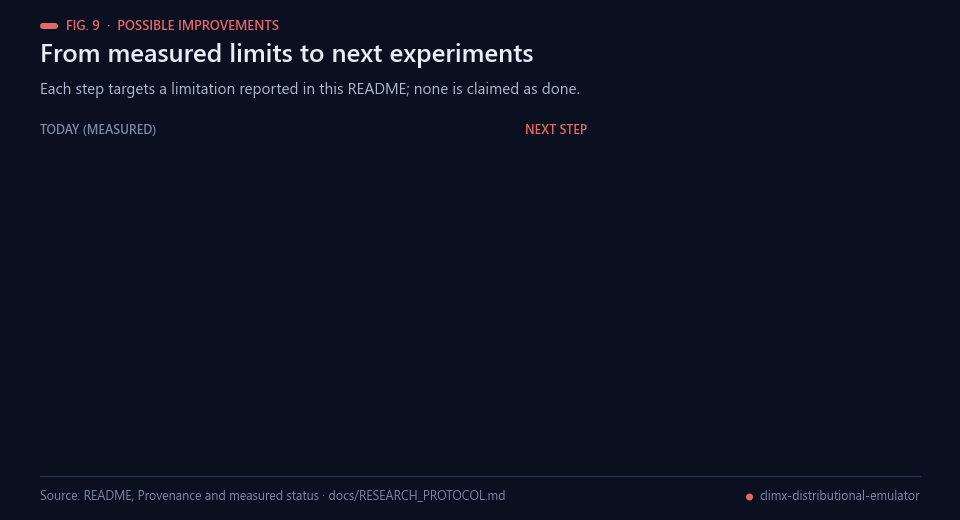<br><sub>Fig. 9 — Each improvement targets a limitation stated in this README.</sub></p>

- **Score on the full official procedure.** The recorded scores are approximate band scores without AR6 regions
  [[10](#ref-10)]; scoring all bands with the official region-wise code would be kept separate from them.
- **Test smoothing properly.** Slope smoothing 5 shows no demonstrated gain (approximately 0.1680 against
  approximately 0.1681). Other widths would need a recorded hypothesis, matched panels and independent seeds or folds
  before any claim.
- **Extend the equivalence check.** The corrected serial-versus-parallel verification covers one band; repeating it on
  more bands and members would strengthen the numerical-equivalence statement, which is not a quality statement.
- **Fixed-control ablation of hybrids.** Any reservoir or pixelflow variant would be added on the daily fields (never in
  index space), against the fixed control described in the [research protocol](docs/RESEARCH_PROTOCOL.md), with
  independent confirmation.

## Future work

<p align="center">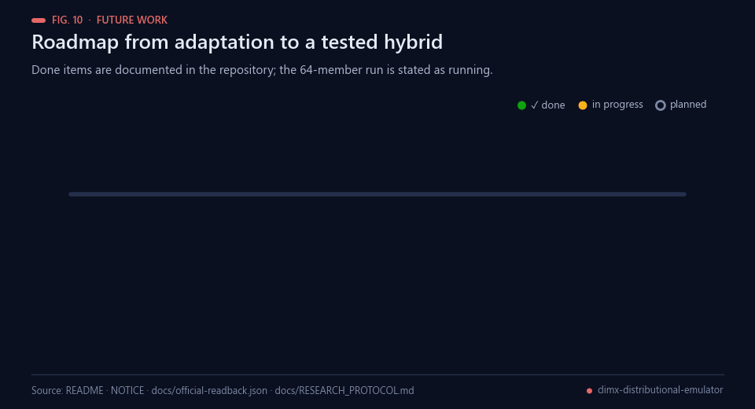<br><sub>Fig. 10 — Completed milestones are documented in this repository; the 64-member run is stated as running.</sub></p>

Planned next steps, in order; only the first is stated as under way:

1. Let the 64-member prediction finish (stated as running, job 1fc48030296c4f63); until then there is no completed
   prediction.
2. Record any official read-back in [docs/official-readback.json](docs/official-readback.json), which currently lists
   no submissions.
3. Repeat the serial-versus-parallel verification on more bands and members.
4. Re-test slope smoothing with other widths under a recorded hypothesis and independent confirmation.
5. Evaluate a reservoir or pixelflow hybrid on the daily fields with a fixed-control ablation, then confirm it
   independently before claiming a gain.

## Licence

Apache-2.0 adaptation, retaining [LICENSE](LICENSE) and [NOTICE](NOTICE). Bundled official scoring code in `ClimX/` retains its separate MIT licence. No competition data or trained weights are redistributed.

## Bibliography

1. <a id="ref-1"></a>Mitchell, T. D. (2003). Pattern Scaling: An Examination of the Accuracy of the Technique for Describing Future Climates. *Climatic Change*, 60(3), 217–242. https://doi.org/10.1023/A:1026035305597
2. <a id="ref-2"></a>Tebaldi, C., & Arblaster, J. M. (2014). Pattern scaling: Its strengths and limitations, and an update on the latest model simulations. *Climatic Change*, 122(3), 459–471. https://doi.org/10.1007/s10584-013-1032-9
3. <a id="ref-3"></a>Eyring, V., Bony, S., Meehl, G. A., et al. (2016). Overview of the Coupled Model Intercomparison Project Phase 6 (CMIP6) experimental design and organization. *Geoscientific Model Development*, 9(5), 1937–1958. https://doi.org/10.5194/gmd-9-1937-2016
4. <a id="ref-4"></a>O'Neill, B. C., Tebaldi, C., van Vuuren, D. P., et al. (2016). The Scenario Model Intercomparison Project (ScenarioMIP) for CMIP6. *Geoscientific Model Development*, 9(9), 3461–3482. https://doi.org/10.5194/gmd-9-3461-2016
5. <a id="ref-5"></a>Zhang, X., Alexander, L., Hegerl, G. C., et al. (2011). Indices for monitoring changes in extremes based on daily temperature and precipitation data. *WIREs Climate Change*, 2(6), 851–870. https://doi.org/10.1002/wcc.147
6. <a id="ref-6"></a>Beusch, L., Gudmundsson, L., & Seneviratne, S. I. (2020). Emulating Earth system model temperatures with MESMER: from global mean temperature trajectories to grid-point-level realizations on land. *Earth System Dynamics*, 11(1), 139–159. https://doi.org/10.5194/esd-11-139-2020
7. <a id="ref-7"></a>Watson-Parris, D., Rao, Y., Olivié, D., et al. (2022). ClimateBench v1.0: A benchmark for data-driven climate projections. *Journal of Advances in Modeling Earth Systems*, 14(10). https://doi.org/10.1029/2021MS002954
8. <a id="ref-8"></a>Bourgault, P., Huard, D., Smith, T. J., et al. (2023). xclim: xarray-based climate data analytics. *Journal of Open Source Software*, 8(85), 5415. https://doi.org/10.21105/joss.05415
9. <a id="ref-9"></a>Cannon, A. J., Sobie, S. R., & Murdock, T. Q. (2015). Bias correction of GCM precipitation by quantile mapping: How well do methods preserve changes in quantiles and extremes? *Journal of Climate*, 28(17), 6938–6959. https://doi.org/10.1175/JCLI-D-14-00754.1
10. <a id="ref-10"></a>Iturbide, M., Gutiérrez, J. M., Alves, L. M., et al. (2020). An update of IPCC climate reference regions for subcontinental analysis of climate model data: definition and aggregated datasets. *Earth System Science Data*, 12(4), 2959–2970. https://doi.org/10.5194/essd-12-2959-2020
11. <a id="ref-11"></a>Koenker, R., & Bassett, G. (1978). Regression quantiles. *Econometrica*, 46(1), 33–50. https://doi.org/10.2307/1913643
12. <a id="ref-12"></a>IPL-UV. *ClimX: a benchmark for extreme-aware climate model emulation* (software and benchmark description; MIT licence; official scoring and submission code). https://github.com/IPL-UV/ClimX
13. <a id="ref-13"></a>maverickss26. *climx-sota-main-track* (public Kaggle notebook, Apache-2.0; source of the forecasting engine adapted in this repository, see NOTICE). https://www.kaggle.com/code/maverickss26/climx-sota-main-track
14. <a id="ref-14"></a>Kaggle. *ClimX main track* (competition page linked from the README of this repository). https://www.kaggle.com/competitions/climx-main-track

---

<div align="center">
<sub>Built by <a href="https://github.com/Agnuxo1">Francisco Angulo de Lafuente</a> · every figure is an animated
rendering of the published file named in its footer, apart from the labelled schematic · <a href="#climx-distributional-emulator">back to top ↑</a></sub>
</div>
