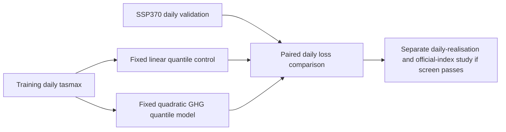

# ClimX recovery and D01 daily-quantile study

Francisco Angulo de Lafuente · ORCID [0009-0001-1634-7063](https://orcid.org/0009-0001-1634-7063).

The original climate emulator has two completed official Kaggle entries. This archive recovers that history and preserves a new, preregistered daily maximum-temperature study with verified CPU arithmetic. The GPU feasibility pilot is queued as of 10 November 2026,12:23 UTC; its result and the full scientific comparison are pending.

| Evidence | Verified result | Scope |
|---|---|---|
| Existing Kaggle entry 57777154 | COMPLETE, public score 0.03070 | Existing 64-member baseline; not a D01 score |
| Existing Kaggle entry 57777260 | COMPLETE, public score 0.02852 | Existing 32-member control |
| D01 CPU verification | Six numerical fixtures passed; 5570 runtime files, 40 raw-band slices and 9 input files checked | CPU arithmetic and artifact identity |
| D01 GPU/scientific result | Pending | No new official entry or measured quality gain |

The old README's cancelled 64-member worker was followed by a successful worker completing all 48 bands. The local recovered parquet and the official entry records are separate evidence: Kaggle does not expose an uploaded-content hash here. See [OFFICIAL_HISTORY.json](OFFICIAL_HISTORY.json).

## One fixed daily-field hypothesis

D01 adds three quadratic greenhouse-gas features to the original conditional daily tasmax quantile model, with a fixed penalty of 100 training-year equivalents. The linear control uses the same data, seasonal transform and predictors. Training uses historical, SSP126 andSSP585; SSP370 is excluded from fitting and used for the prospective comparison on eight fixed full-resolution latitude bands. Earlier studies have already examined these scenarios, so this is not an untouched external confirmation.

The screening metric is truncated continuous ranked probability score in Kelvin, obtained from quantile pinball loss over probabilities 0.01 through0.99. The fixed gate requires at least 0.25% reduction and a positive lower 95% endpoint from a paired 10-year circular-block bootstrap (10000 replicates, seed20261110). This is a univariate distribution screen on selected bands, rather than the official regional 15-index metric. A screening pass requires a separate daily-realisation and official-index evaluation before candidate promotion. The [protocol](PROTOCOL.md) gives the full scope and limitations.

## Current rules and reproducibility

The [official rules](https://www.kaggle.com/competitions/climx-main-track/rules) require daily-field outputs followed by official index computation. Recovered neural index-residual families are excluded from this candidate path. Training here uses only organizer-provided data; no CMIP6-pretrained model is used. Public code is also shared through the associated Kaggle notebook, as required by section 3.6b.

The immutable source package retains the seven original emulator files unchanged and includes the new GPU sufficient-statistic model and runner. CPU and CUDA arithmetic must match the NumPy reference. The final CPU report matches the exact source and input manifests. Single-attempt execution markers are atomic; bytecode reads use an empty prefix. The immutable implementation keeps explicit paths for this audited experiment. [REPRODUCE.md](REPRODUCE.md) provides installation, data-store construction, data-free CPU checks and input/runtime-manifest regeneration commands. The helper creates a separate path-adapted copy with its own identity; the archived source stays unchanged. Its CPU fixtures and full existing-store fingerprint/verify flow were executed successfully, as recorded in [CPU_REPRODUCTION.json](CPU_REPRODUCTION.json). A fresh full-data download and clean dependency installation were not repeated.

## Attribution and archive contents

The distributional forecasting engine is adapted from [maverickss26's public Kaggle notebook](https://www.kaggle.com/code/maverickss26/climx-sota-main-track), credited in the retained Apache-2.0 [NOTICE](source/NOTICE) and[LICENSE](source/LICENSE). The new D01 fitting and screening code is by Francisco Angulo de Lafuente under Apache-2.0. The original separate official ClimX repository keeps its MIT licence; that tree is not bundled in this source package.

This archive contains source, protocol, hashes and aggregate verification. Competition observations, prediction maps, trained weights, credentials and private contact details are absent. The CPU-only Kaggle notebook materialises the identical source archive; it is a backup, not a competition submission.
